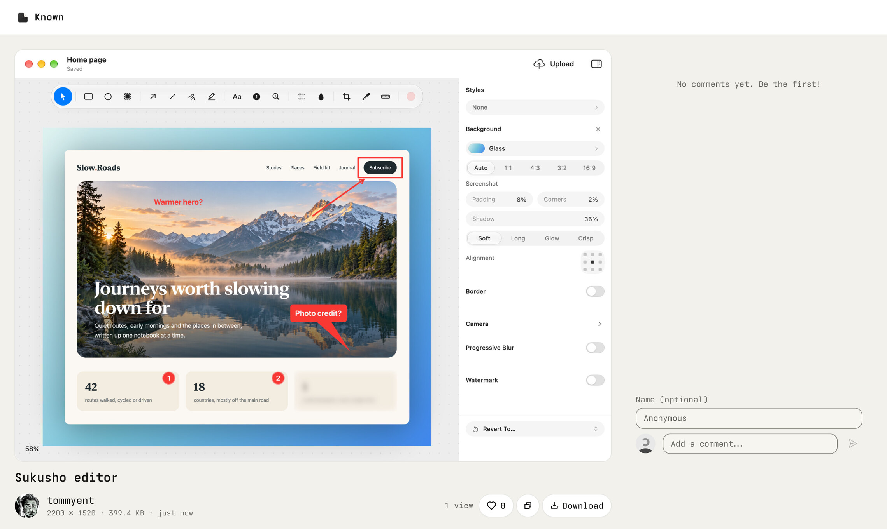
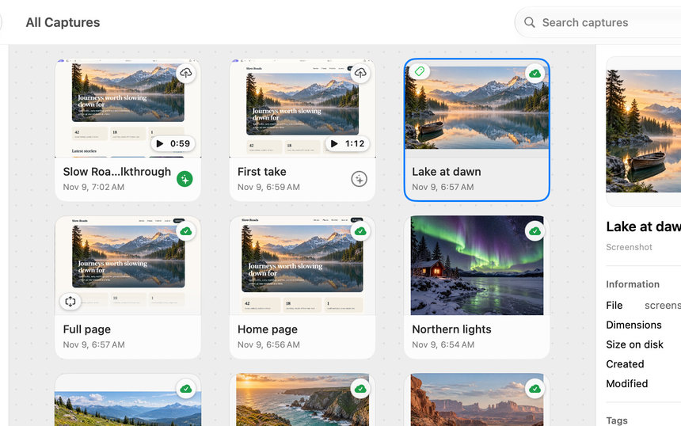
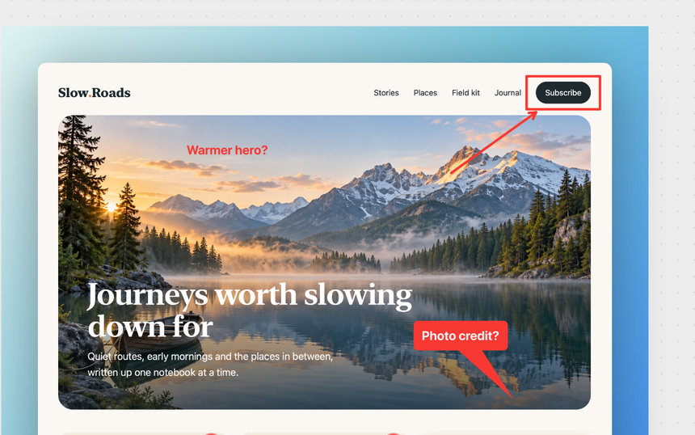
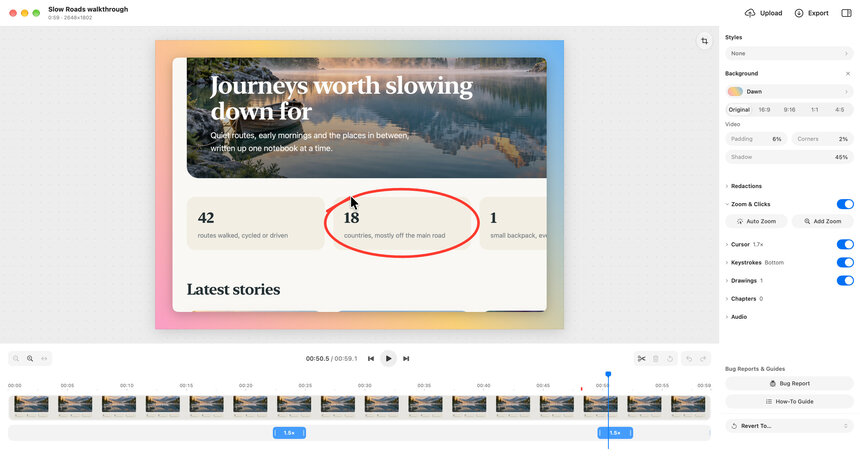
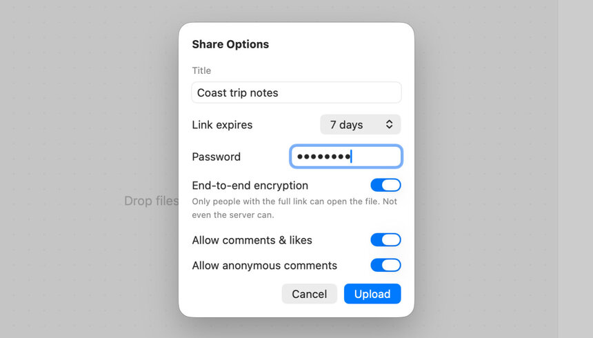
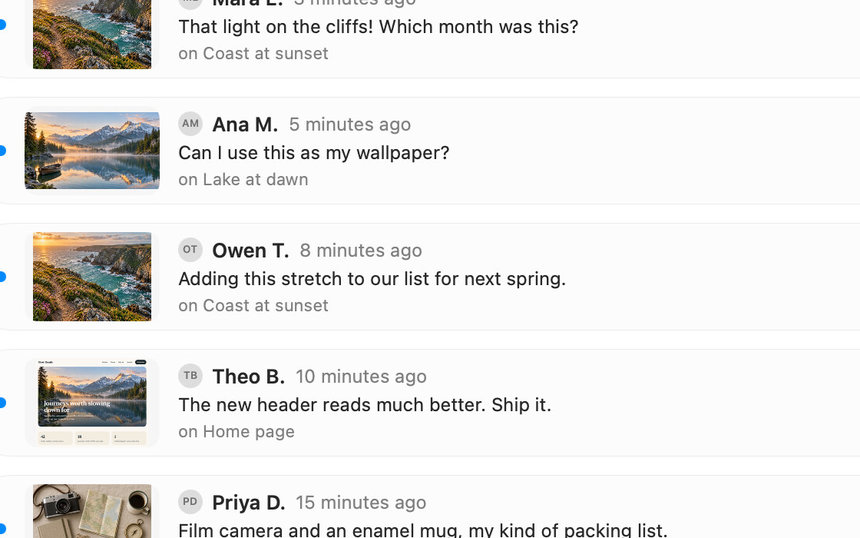
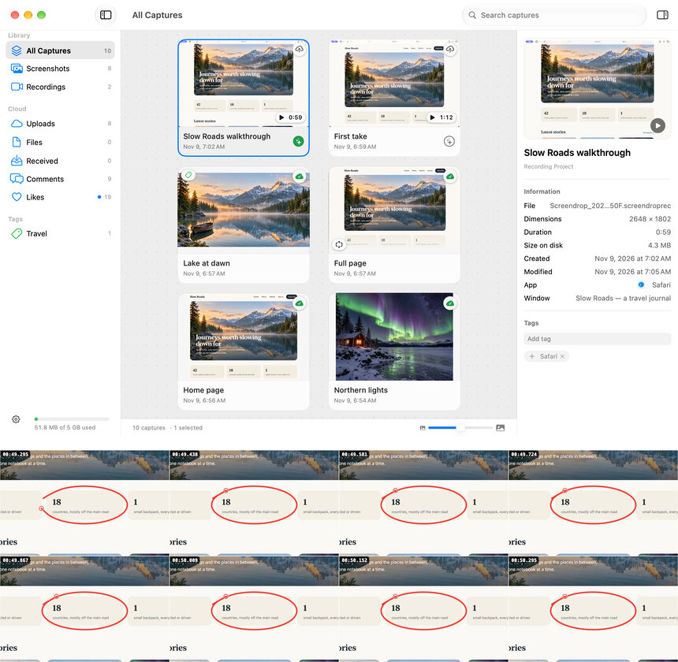
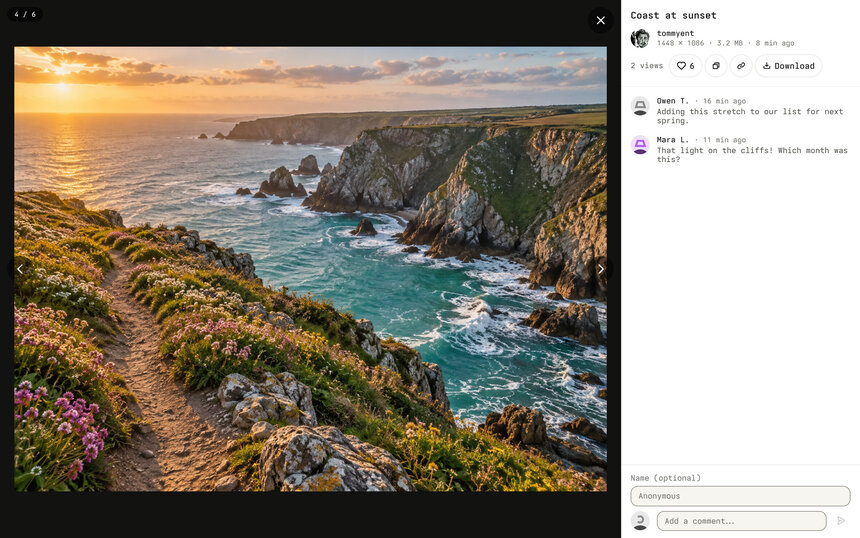

<h1 align="center">
  <picture>
    <source media="(prefers-color-scheme: dark)" srcset="docs/brand/readme-header-dark@2x.png">
    
  </picture>
</h1>

  Capture, record, and mark up your Mac's screen; share any file and request files through your own Cloudflare account.

  <a href="https://github.com/tommyent/sukusho/releases/latest"><strong>Download</strong></a> ·
  <a href="https://tommyent.github.io/sukusho/"><strong>Website</strong></a> ·
  <a href="docs/features.md"><strong>All features</strong></a> ·
  <a href="docs/"><strong>Docs</strong></a>

## Features

Click a picture to see it full size.

<table>
  <tr>
    <td width="33%" valign="top"> <b>Library</b> with search inside captures</td>
    <td width="33%" valign="top"> <b>Image editor</b> with labels, arrows and blur</td>
    <td width="33%" valign="top"> <b>Screen recording</b> and Studio</td>
  </tr>
  <tr>
    <td valign="top"> <b>Scrolling Capture</b> of a whole page</td>
    <td valign="top"> <b>Share links</b> with expiry, password and end-to-end encryption</td>
    <td valign="top"> <b>Comments and likes</b> come back to the Library</td>
  </tr>
  <tr>
    <td valign="top"> <b>Galleries</b>: up to 100 screenshots behind one link</td>
    <td valign="top"> <b>Bug Report</b> and How-To Guide for coding agents</td>
    <td valign="top"> <b>Gallery lightbox</b> with comments and likes</td>
  </tr>
</table>

[All features →](docs/features.md)

## Install

1. [Download Sukusho](https://github.com/tommyent/sukusho/releases/latest) and open the DMG.
2. Drag Sukusho to Applications and open it.
3. Allow Screen & System Audio Recording when macOS asks.

Sharing uses a Worker in your own Cloudflare account: [set it up](docs/sharing-setup.md).

Tested on macOS 27.0.1 and 27.3 on Apple silicon. Signed and notarized; updates are available in the app.

## Docs

[Features](docs/features.md) · [Privacy and permissions](docs/privacy.md) · [Sharing setup](docs/sharing-setup.md) · [Build from source](docs/building.md) · [Release notes](docs/releases/)

## Credits and licence

Sukusho began as a fork of [Screendrop](https://github.com/fayazara/Screendrop) by Fayaz Ahmed and is now a separate project, not affiliated with or supported by Screendrop. Please report Sukusho problems here.

Screendrop's code is available under [CC0 1.0 Universal](LICENSE-CC0); this fork's own changes are under the [MIT License](LICENSE). See [NOTICE](NOTICE) for details and third-party licences.
