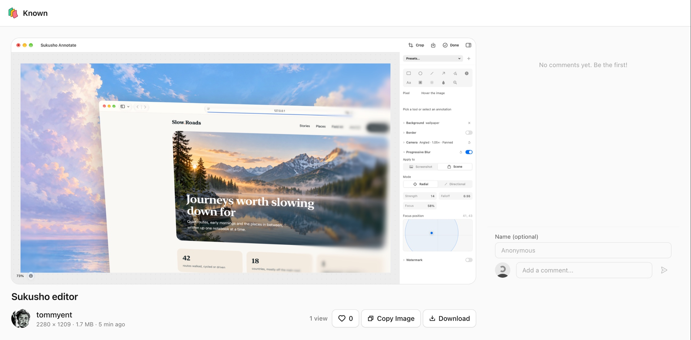
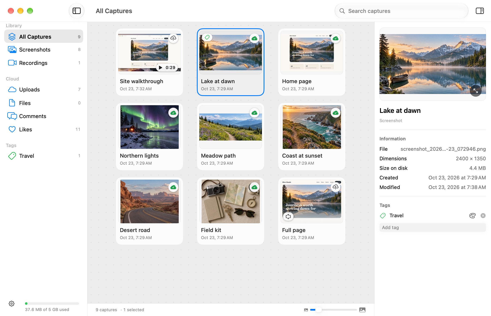
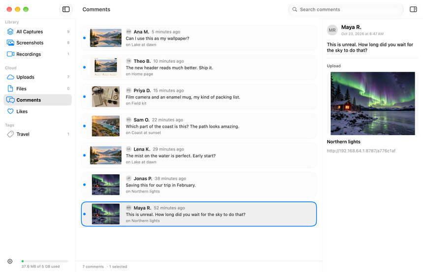
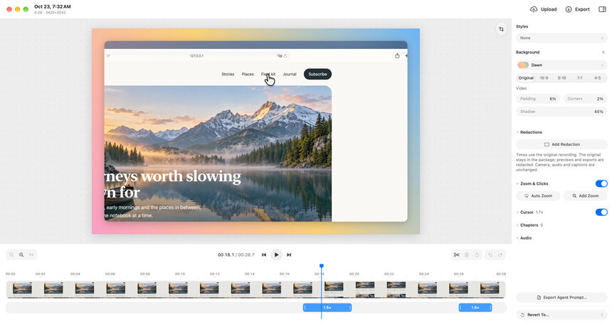
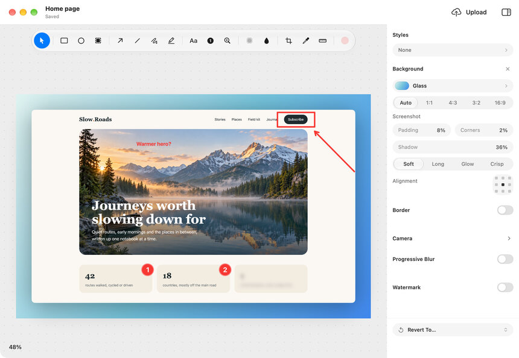
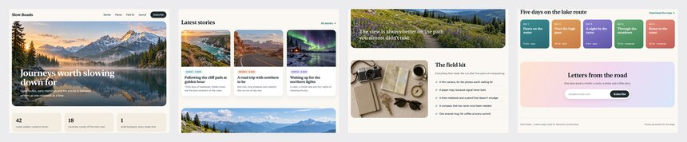

<h1 align="center">
  <picture>
    <source media="(prefers-color-scheme: dark)" srcset="docs/brand/readme-header-dark@2x.png">
    
  </picture>
</h1>

Sukusho captures the screen on a Mac and hands someone a link from the project's own Worker, with the markup, the cut and their comments on that same capture. The Worker runs in your own Cloudflare account, so your uploads, comments and likes stay there, with no Sukusho service in between.

Sukusho started as a fork of [Screendrop](https://github.com/fayazara/Screendrop) by Fayaz Ahmed, and thanks go to that project for the foundation. It has since grown into a separate project: a heavily modified app with its own features, its own name and app identity, and its own Cloudflare Worker for share pages. The two apps install side by side and don't share updates.

> [!IMPORTANT]
> Sukusho is not affiliated with or supported by Screendrop or its author. Please report Sukusho problems here, not to the Screendrop project.

> [!NOTE]
> There are no releases yet. To use Sukusho, [build it from source](#building-from-source). It is under active development, so expect rough edges.

<a href="https://screendrop-worker.tommyent.workers.dev/cfcda18c"></a>

This is a typical share page, as the person you send a link to sees it: the capture, a like button, Copy Image and Download, and a place to comment. Comments can be turned off for each share. The page carries the name and logo you choose in Sukusho's settings. [Open the demo share](https://screendrop-worker.tommyent.workers.dev/cfcda18c), which has comments turned off.

## Screenshots

The Library keeps your captures in one window, next to everything that came back from your share pages: uploads, shared files, comments and likes.

<a href="docs/screenshots/library.jpg"></a>

Click a picture to see it full size.

<table>
  <tr>
    <td width="50%" valign="top">
      <a href="docs/screenshots/comments.jpg"></a>
      <br><b>Comments</b> from your share pages arrive in the Library, each with the upload it's on.
    </td>
    <td width="50%" valign="top">
      <a href="docs/screenshots/studio.jpg"></a>
      <br><b>Studio</b> edits a recording before you export or upload it.
    </td>
  </tr>
  <tr>
    <td width="50%" valign="top">
      <a href="docs/screenshots/editor.jpg"></a>
      <br>The <b>editor</b> marks up a screenshot and sets it on a background.
    </td>
    <td width="50%" valign="top">
      <a href="docs/screenshots/scrolling-capture.png"></a>
      <br><b>Scrolling Capture</b> turns a whole page into one tall image, shown here in four columns.
    </td>
  </tr>
</table>

## Features

### Sharing

Sharing is optional and self-hosted. Uploads go to a Cloudflare Worker you deploy, which keeps files in R2 and their details in D1. Sukusho only needs the Worker's URL and an upload token ([set up the Worker](#setting-up-the-worker)).

- **Share pages:** screenshots get a clean viewer with Copy Image and Download. Recordings get a video player with captions, a searchable transcript, chapters and previews as you scrub. Pages count views and show a preview card when the link is pasted into a chat app.
- **Upload from anywhere:** after a capture, from its preview card, from the Library, or from Studio, which uploads the finished cut. The link is copied when the upload finishes.
- **Share Options:** a title, a link expiry, an optional password, whether comments and likes are allowed, and whether people can comment without signing in. Expiry, password and anonymous comments can be changed after upload, in the inspector on the Library's Uploads page.
- **Comments and likes** come back to the Library, newest first, each with the upload it belongs to. The sidebar counts the new ones.
- **Files:** the Library's Files page shares files of any kind. Drop them on the page or click **Add Files…**, choose the same Share Options, and the links are copied.
- **Settings → Cloud** sets the default link expiry, the share page's name, logo and favicon, and a storage threshold. A bar at the foot of the Library's sidebar shows how much the Worker stores against it; it turns amber at 80% and red at the threshold, and never blocks an upload.
- If you add redactions to a recording that's already shared, Studio says the link still shows the old version and offers to replace the shared video, keeping the same link.

### Library

One window for screenshots, recordings and recording projects, with **Uploads**, **Files**, **Comments** and **Likes** under Cloud.

- Cards with an adjustable size, search (**Command + F**), and filters for screenshots or recordings. Tags have their own colours and icons.
- An inspector with dimensions, dates, duration, disk use and tags (**Option + Command + I** shows or hides it).
- Right-click a capture for **Quick Look**, **Edit**, **Rename**, **Revert to Original…** (on an edited capture), **Copy**, **Export…**, the system **Share…** sheet, **Reveal in Finder** and **Move to Trash**. Recordings add **Export as GIF…** and **Export Agent Prompt**. The same menu holds the cloud actions: **Share to Cloud…** before upload; **Copy Cloud Link**, **Open Shared Capture** and **Delete from Cloud…** after.
- Each card has a cloud badge: click it to share the capture, or to copy its link once shared. Shared captures show a green cloud with a tick.
- Right-click between the cards to change the sort order or **Refresh** (**Command + R**).
- **Space** opens Quick Look and **Return** renames. Select several captures to copy, export, share, reveal or trash them together.

Opening Sukusho shows the Library; when it starts at login, it stays in the menu bar.

### Screen recording and Studio

- Record a display, a window or an area, with a camera, a microphone and system audio as separate sources, a 1, 3 or 5 second start timer, and a teleprompter that follows your narration on-device. **Clean desktop**, on by default, keeps desktop icons, the Dock and notification banners out of display and area recordings without changing your real desktop.
- A floating bar shows the time and a microphone level meter, and pauses, starts over, stops or discards the take.
- Every recording is a non-destructive project. In Studio, split, trim and delete clips, change their speed, add automatic or manual zooms, and show a reconstructed cursor, click highlights and keystroke captions. Move and resize the camera, crop the video, and set a background, padding, corners, shadow and an aspect ratio for social formats. **Styles** saves a look to reuse, with import and export.
- **Audio:** **Isolate voice** cleans the microphone track with Apple's voice isolation. Add background music from your own file or from the [Free To Use](https://freetouse.com/music) library, looped to fit, starting where you choose, lowered while you speak, and faded out at the end.
- **Redactions:** blur or pixelate a region for part of the recording. They apply to every preview, export and share, and the original footage stays untouched.
- **Words:** transcribe your narration on-device, edit the captions, or cut the video by deleting words from its transcript. Chapters can be suggested from pauses and are named from what you said; the share page lists them so viewers can jump.
- **Output:** export the finished video as MOV, MP4 or GIF, export its audio, or click **Upload** to send it to your Worker and copy the link. **Export Agent Prompt** writes a folder in `~/Agent Prompts` with `prompt.md` and stills of what was said, clicked and pressed, to hand a walkthrough to a coding agent; `~/Agent Prompts/latest.json` names the newest one.
- Studio has no Save button: a project saves after a two-second pause, when you switch away, close or quit, and with **File → Save** (**Command + S**). **File → Revert To** goes back to the original recording, to how the window opened, or to one of the last five sessions. Double-click the title to rename the recording.

### Image editor

Editing is non-destructive. The untouched image and an editable copy of your markup are kept side by side, so annotations can be changed later, and exports render at the image's full resolution.

- **Saves by itself** after a two-second pause, when you switch away, close or quit, and with **File → Save** (**Command + S**). The title bar shows the capture's name with **Edited**, **Saving…** or **Saved**; double-click it to rename. **File → Revert To** goes back to the capture as taken, to how the window opened, or to one of the last five sessions.
- **Tool dock** floating over the canvas: Select, rectangle, circle, Spotlight, arrow, straight line, freehand, Highlighter, text, numbered circle, magnifier, pixelate and blur, then **Crop**, **Pick Color**, **Measure** and a colour and size pill. Most tools have a single-key shortcut (R, O, L, A, N, T, M, P, B, and C for Crop).
- **Place a shape, then adjust it:** shapes, arrows, lines, magnifiers and redactions return to Select with the new annotation selected. Freehand, Highlighter and numbered circles stay armed for the next stroke or number. The Highlighter draws a straight horizontal or vertical line in see-through yellow, with its own remembered style.
- **Copy and paste:** **Command + C** and **Command + V** copy and paste the selected annotations. Paste an image from the clipboard to add it as a picture you can move and resize; dragging it past the edge grows the canvas.
- **Pick Color** copies a pixel's hex colour (or press **Tab** over the image). **Measure** shows the width and height under the pointer; hold **1** for height or **2** for width with any tool.
- **Crop** freeform or to a fixed ratio, or **Command-click** the image to crop to the box under the pointer. Annotations follow the crop.
- Shapes snap to each other and to the image's edges and centre, with alignment guides. The colour popover includes an opacity slider.
- **Find sensitive text…**, with pixelate or blur chosen, finds sensitive text and covers it.
- **Inspector:** **Styles** saves and reapplies a whole look, sets a default for new screenshots, and imports or exports `.screendroppreset` files. **Background** offers colours, gradients, wallpapers, your own images and [Unsplash](https://unsplash.com/oauth/applications) search with your own Access Key. Add padding, corner radius, shadow, a border, a watermark, a camera angle and progressive blur.

### Capture

Capture a display, a window, an area, a scrolling region, or just the text in an area. Sukusho runs from its menu bar item and global shortcuts:

| Default shortcut | Action |
| --- | --- |
| `Command + Shift + 1` | Capture full screen |
| `Command + Shift + 2` | Capture a window |
| `Command + Shift + 3` | Capture an area |
| `Command + Shift + 4` | Scrolling Capture |
| `Command + Shift + 5` | Capture Text to the clipboard |
| `Command + Shift + 6` | Screen recording |

`Command + Shift + 3`, `4` and `5` are also macOS's own screenshot shortcuts, so turn those off in macOS's keyboard shortcut settings (under Screenshots) for Sukusho to get them. Change any shortcut in **Settings → General**. If a shortcut can't be registered, Settings says why and keeps the previous one.

- **Screenshot options** in **Settings → Screenshots**: a 3, 5 or 10 second timer, window shadows, trimming the empty menu bar strip from full-screen captures on notched Macs, PNG or JPEG, and an option to also copy as TIFF for apps that can't paste PNG.
- **After each capture**, choose any of: show the preview, copy, save, upload and copy the link, and open the editor or pin the screenshot above other windows. Recordings have their own set, and open in Studio by default.
- **Floating preview cards** let you copy, drag, save, compress, pin, view, edit, upload or delete a capture. Rearrange their actions, and set where they appear and when they close, in **Settings → Overlay**.
- **Capture Text** drags out an area, reads its text on-device, and puts the text on the clipboard. No image is saved.
- **Open With → Sukusho** in Finder imports a copy of an image and opens the copy in the editor. The original file is never changed.

### Scrolling Capture

Draw a box over a scrolling view, then scroll through it yourself or click the auto-scroll button on the capture bar. Sukusho lines up each new frame with the last one and adds only the rows that scrolled into view, giving one tall image up to 16,384 pixels high.

- **Auto-scroll** moves the view a step at a time, paced by what has been captured, and finishes by itself at the end of the page. Scrolling yourself or moving the pointer off the bar hands control back to you. Auto-scroll needs the Accessibility permission; the bar offers to open it.
- **Every frame is checked before it's added.** Apple's Vision framework proposes where the new frame fits, and Sukusho adds it only once an exact pixel match confirms it. A frame that doesn't fit is skipped, not joined in the wrong place.
- **The capture bar** stays quiet through brief misses. If frames keep failing to fit, it says **Scroll back a little** when the view has moved past where it can line up, or **Something on the page keeps changing** for a video, an animation or a hover.
- Click **Done**, or press the Scrolling Capture shortcut again, to keep everything captured so far. At the height limit the capture stops and waits for **Done**.

Draw the box around the part that scrolls: a sidebar or button that stays put inside the box is repeated down the image.

### Automation

Shortcuts, Siri and Spotlight can take a full-screen, window or area screenshot, capture text, and start, stop or toggle a screen recording.

## Privacy and permissions

- Captures, projects, edits and transcripts stay on your Mac. Transcription and text recognition run on-device.
- The upload token and your Unsplash Access Key are kept in the Keychain. Captures are uploaded only when you, or an after-capture action you turned on, ask for it.
- There is no Sukusho account, no central Sukusho server and no automatic app updates. Sukusho goes online for your Worker, a check on GitHub for a newer Worker version in **Settings → Cloud**, Unsplash search and wallpaper downloads, Free To Use music search and downloads, and the setup video in **Settings → Cloud** when you play it. Apple's on-device speech models may need a one-time download for transcription or the teleprompter.

macOS asks for **Screen & System Audio Recording** for captures and recordings, and, when you first use them, **Camera**, **Microphone**, **Input Monitoring** (for keystroke captions) and **Accessibility** (for auto-scroll). Sukusho's own windows are left out of captures unless you turn on **Settings → General → Include Sukusho windows in captures**.

## Building from source

Requirements:

- macOS 27.0 or newer.
- Xcode 27 beta (installed as `Xcode-beta.app`), with its Metal Toolchain for Studio's motion-blur shader:

  ```bash
  xcodebuild -downloadComponent MetalToolchain
  ```

- Your Apple Developer team ID, to sign the app.

Build Sukusho with your team ID in place of `YOUR_TEAM_ID`:

```bash
xcodebuild build -project Screendrop.xcodeproj -scheme Screendrop \
  -configuration Release -destination "platform=macOS" \
  DEVELOPMENT_TEAM=YOUR_TEAM_ID -allowProvisioningUpdates
```

The `Screendrop` scheme builds `Sukusho.app` (`com.tommyent.Sukusho`). The `Screendrop Dev` scheme with the `Debug Dev` configuration builds `Sukusho Dev.app` (`com.tommyent.Sukusho.dev`), which keeps its own data folder and keychain item, apart from Sukusho's. The Xcode target, schemes and Swift module keep the name Screendrop.

Run the test suite:

```bash
xcodebuild test -project Screendrop.xcodeproj -scheme "Screendrop Dev" \
  -configuration "Debug Dev" -destination "platform=macOS" \
  DEVELOPMENT_TEAM=YOUR_TEAM_ID -allowProvisioningUpdates
```

The tests use Swift Testing, need no app host, and never touch your captures or settings; see [ScreendropTests/README.md](ScreendropTests/README.md). DockProgress is the only package dependency, and Xcode resolves it. [Editor performance](docs/editor-performance.md) and [export performance](docs/export-performance.md) describe the standalone checks and benchmarks.

If Screendrop was installed before, Sukusho brings over its captures, recordings, settings and Cloud token once, the first time it opens. Screendrop's own copy is left unchanged.

## Setting up the Worker

Sukusho's share pages, comments, likes and passwords come from this fork's Worker, [tommyent/screendrop-worker](https://github.com/tommyent/screendrop-worker), built on Cloudflare Workers with R2 and D1.

1. In Sukusho, open **Settings → Cloud** and copy the generated upload token.
2. Deploy the Worker from its repository:

   ```bash
   git clone https://github.com/tommyent/screendrop-worker.git
   cd screendrop-worker
   pnpm install
   npx wrangler secret put UPLOAD_TOKEN   # paste the token from step 1
   pnpm run deploy
   ```

   The deploy provisions the R2 bucket and D1 database; the database schema sets itself up on first use.
3. Paste the Worker's URL into **Settings → Cloud** and click **Verify Connection**.

Optional `AUTHOR_NAME` and `AUTHOR_AVATAR` secrets set the name and picture shown beside each share. The Worker's README covers updating an existing deployment and its API.

## Credits and licence

Sukusho is based on [Screendrop](https://github.com/fayazara/Screendrop) by Fayaz Ahmed, which its author dedicated to the public domain under [CC0 1.0 Universal](LICENSE-CC0). Code that came from Screendrop remains available under CC0. This fork's own changes are licensed under the [MIT License](LICENSE). See [NOTICE](NOTICE) for the details and for the licences of third-party packages.
