# Features

## Sharing

<a href="screenshots/share-page.jpg">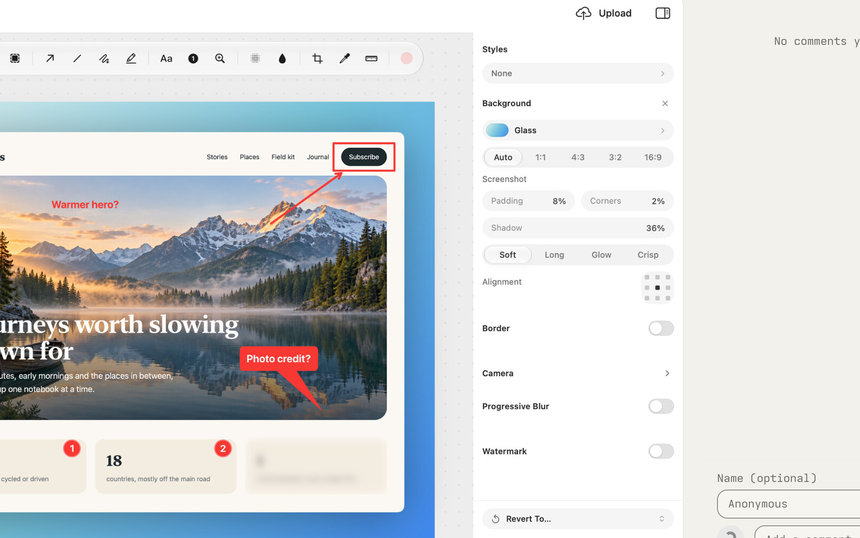</a>

Sharing is optional and self-hosted. Uploads go to a Cloudflare Worker you deploy, which keeps files in R2 and their details in D1. Sukusho only needs the Worker's URL and an upload token ([set up the Worker](sharing-setup.md)).

- **Share pages:** screenshots get a clean viewer with Copy Image and Download. Recordings get a video player with captions, a searchable transcript, chapters and previews as you scrub, and, on a Worker 2.1.0 or later, the recording's summary and a menu of the caption languages you translated in Studio. Pages follow the viewer's light or dark setting, count views and show a preview card when the link is pasted into a chat app.

<a href="screenshots/gallery.jpg">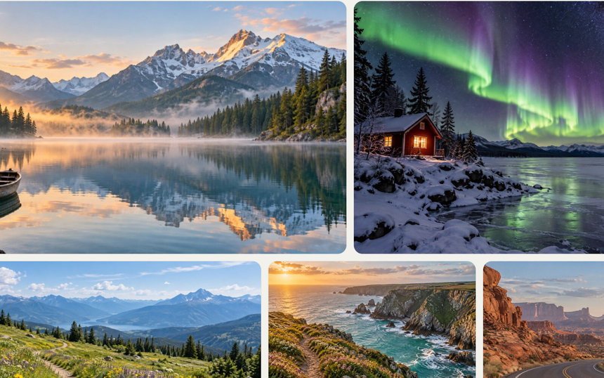</a>

<a href="screenshots/gallery-lightbox.jpg">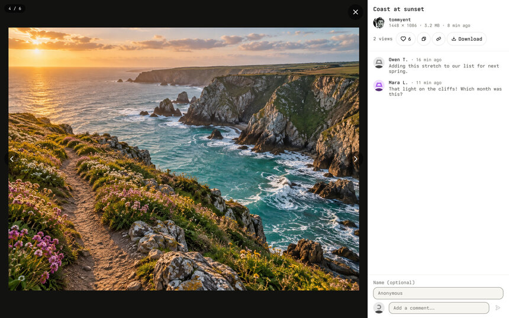</a>

- **Galleries:** select 2 to 100 screenshots in the Library and choose **Share to Cloud…** to send them behind one link: a page of thumbnails that open in a lightbox, where each image keeps its own likes, comments and views. The title, expiry, password and comment settings cover the whole gallery. It needs Worker 2.0.0 or later; with an older one the menu says to update it.
- **Upload from anywhere:** after a capture, from its preview card, from the Library, or from Studio, which uploads the finished cut. The link is copied when the upload finishes.

<a href="screenshots/share-options.jpg">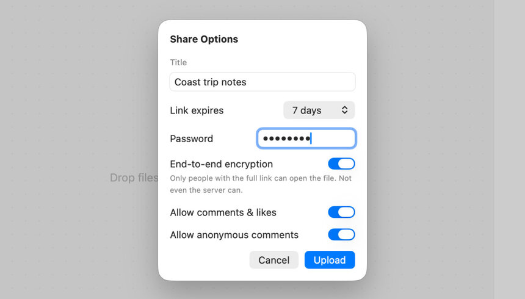</a>

- **Share Options:** a title, a link expiry, an optional password, **End-to-end encryption**, whether comments and likes are allowed, and whether people can comment without signing in. Expiry, password and anonymous comments can be changed after upload, in the inspector on the Library's Uploads page. When sharing one capture, **Draft Message** has Apple Intelligence write a short note to send with the link, on this Mac, from the title and, for a recording, its summary and chapters. You can edit it; when the upload finishes, the note and the link are copied together, so one paste fills the email. The note is never uploaded.
- **End-to-end encryption:** with it on, an image or a file of up to 32 MB is sealed on your Mac with CryptoKit before it's uploaded. The key goes only in the part of the link after `#`, which browsers don't send, so the Worker stores a file it can't read, and the recipient's browser decrypts it. The key is kept in this Mac's Keychain, so the full link can be copied again only from this Mac. Recordings aren't encrypted, because their share page needs the video for its poster, previews and seeking.
- **File requests:** on the Library's **Received** page, **Request Files…** makes a link someone can use to send you files, with an optional message and password, an expiry of 1, 7 or 30 days, and limits on how many files and how large. The link is copied when it's made and kept in this Mac's Keychain, so **Manage** beside the button can copy it again; the Worker keeps only a fingerprint of it, so a link made on another Mac can't be copied here. Senders pass a bot check; what they send is private to you and isn't scanned for malware. While a request is open and Sukusho is running, it checks every five minutes and notifies you of new files. Received files download to Downloads or a folder you choose in **Settings → Cloud**, automatically if you turn that on, and are marked as downloaded from the internet so macOS checks them when they're opened.

<a href="screenshots/comments.jpg">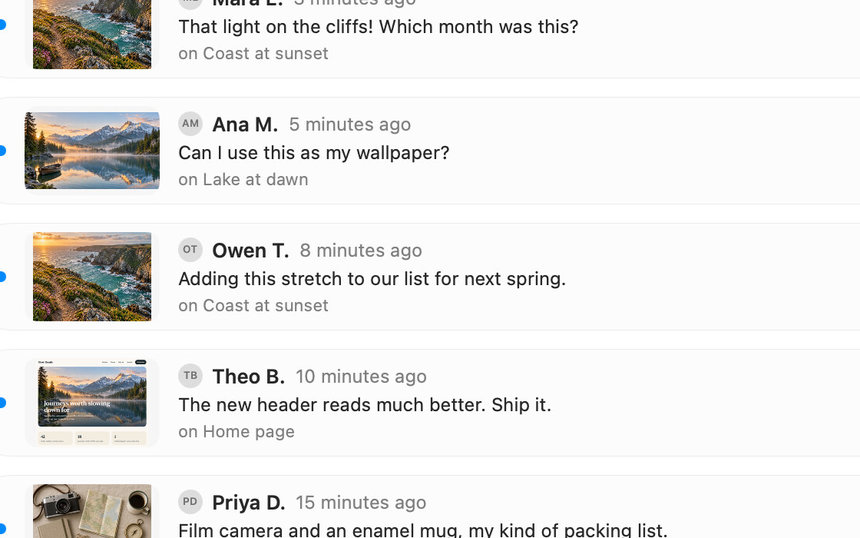</a>

- **Comments and likes** come back to the Library, newest first, each with the upload it belongs to. The sidebar counts the new ones.
- **Files:** the Library's Files page shares files of any kind. Drop them on the page or click **Add Files…**, choose the same Share Options, and the links are copied.
- **Shake to upload:** turn on **Settings → Cloud → Shake while dragging files to upload**, then shake the pointer while you drag files from Finder or the Desktop, and a small shelf appears under it. Drop on **Share…** to choose Share Options, on **Upload Now** (or hold Option) to use your saved defaults, or, for two or more images on a Worker with galleries, on **Gallery…** to share them behind one link. The links are copied. Esc cancels the drag as usual and puts the shelf away, as does a drop anywhere else.
- **Cloud settings:** **Settings → Cloud** sets the default link expiry, the share page's name, logo and favicon, and a storage threshold. A bar at the foot of the Library's sidebar shows how much the Worker stores against it; it turns amber at 80% and red at the threshold, and never blocks an upload.
- **Replace a shared recording:** if you add redactions to a recording that's already shared, Studio says the link still shows the old version and offers to replace the shared video, keeping the same link.

> [!NOTE]
> End-to-end encryption and file requests need Worker 2.0.0 or later. With an older Worker, Sukusho says so: Request Files asks you to update it, and an encrypted upload is removed instead of being shared.

## Library

One window for screenshots, recordings and recording projects, with **Uploads**, **Files**, **Received**, **Comments** and **Likes** under Cloud.

<a href="screenshots/library.jpg">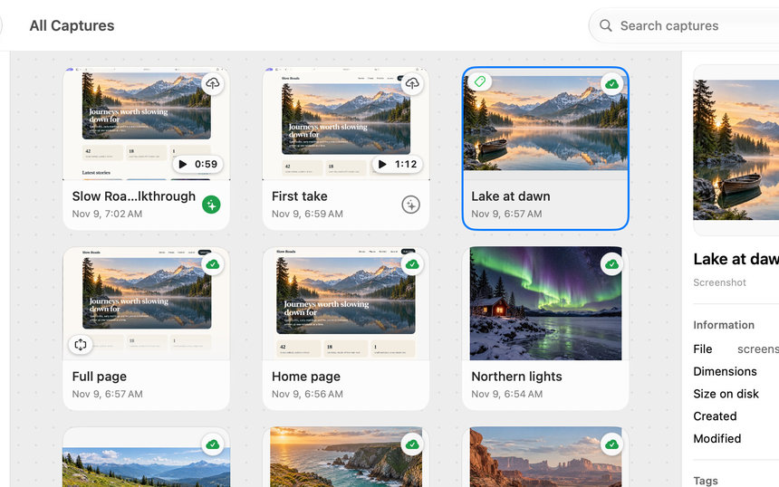</a>

- **Capture cards:** adjustable size, search (**Command + F**), and filters for screenshots or recordings. Tags have their own colours and icons.
- **Search inside captures:** search matches names, titles, tags, the app and window a capture was taken from, and the words in it. The Library reads the text in screenshots, and in recordings three frames plus their captions, on your Mac. Type `app:` and a name, such as `app:safari` or `app:"visual studio"`, to keep only captures taken in that app.
- **Capture inspector:** dimensions, dates, duration, disk use, the app and window a capture came from, the text read in it (with **Copy Text**), and tags (**Option + Command + I** shows or hides it). It suggests tags, starting with the app's name; a suggestion is added only when you click it, and one you dismiss stays gone for that capture.
- **Apple Intelligence**, where it's available, names captures you haven't named and suggests more tags, from the text read in them, on your Mac. **Settings → Library** turns text reading and this off, and titles older captures when you click **Start**.
- **Capture actions:** right-click a capture for **Quick Look**, **Edit**, **Rename**, **Revert to Original…** (on an edited capture), **Copy**, **Export…**, the system **Share…** sheet, **Reveal in Finder** and **Move to Trash**. Recordings add **Export as GIF…**, **Export Bug Report** and **Export How-To Guide**. The same menu holds the cloud actions: **Share to Cloud…** before upload; **Copy Cloud Link**, **Open Shared Capture** and **Delete from Cloud…** after.
- **Cloud badges:** each card has a cloud badge: click it to share the capture, or to copy its link once shared. Shared captures show a green cloud with a tick.
- **Sort and refresh:** right-click between the cards to change the sort order or **Refresh** (**Command + R**).
- **Keyboard and batch actions:** **Space** opens Quick Look and **Return** renames. Select several captures to copy, export, share, reveal or trash them together.
- **Appearance:** **Settings → General → Appearance → Theme** keeps Sukusho's windows **Light** or **Dark**, or follows macOS with **Automatic**, the default.
- **Custom Library backgrounds:** **Settings → General → Appearance** sets what the Library, the image editor and Studio draw behind your captures: **Dots** (the default), **Plain** grey, or a **Wallpaper**: one of the wallpapers the screenshot background keeps, an image you add (Sukusho keeps its own copy) or an Unsplash photo. **Dim** fades it into the grey, more in dark mode, and **Blur** softens it. It never appears in captures, exports or uploads. With Reduce Transparency or Increase Contrast on, the workspaces stay plain grey.

<a href="screenshots/library-background.jpg">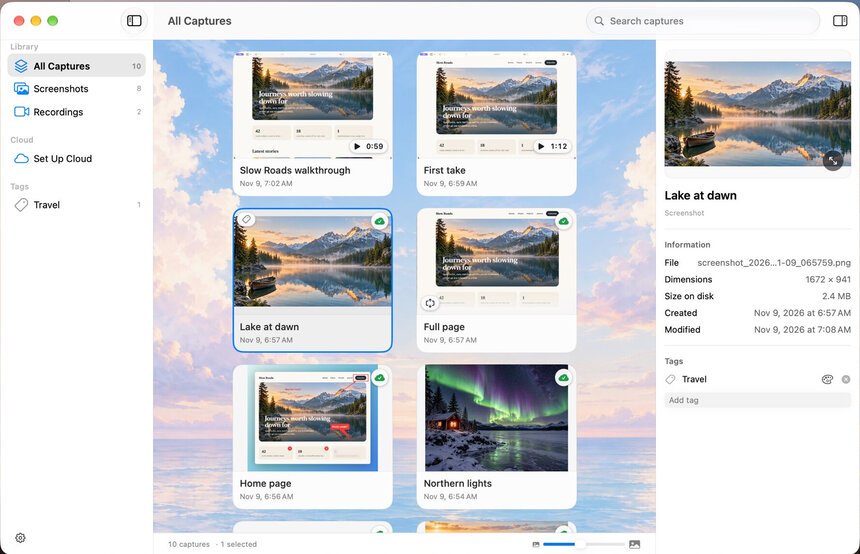</a>

Opening Sukusho shows the Library; when it starts at login, it stays in the menu bar.

## Screen recording and Studio

<a href="screenshots/studio.jpg">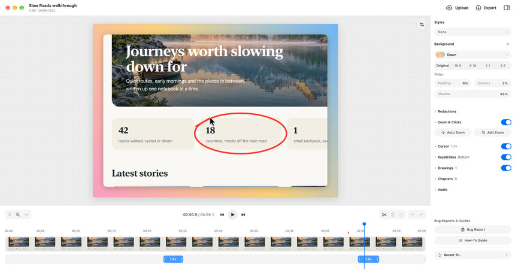</a>

- **Recording sources:** record a display, a window or an area, with a camera, a microphone and system audio as separate sources, a 1, 3 or 5 second start timer, and a teleprompter that follows your narration on-device. **Clean desktop**, on by default, keeps desktop icons, the Dock and notification banners out of display and area recordings without changing your real desktop. **Bug report**, on the same bar, records a take for a coding agent: it keeps the menu bar, notification banners and Sukusho's own windows in (the bar's usual switch can leave Sukusho out again), and **Stop** writes its bug report straight away instead of opening Studio. With Bug report on, **App logs** (off by default, and off again after each take) also reads the recorded app's own unified log for the length of the take: its errors, faults and default-level messages, up to 2,000 errors and faults and 1,000 other lines. It needs an administrator account, since macOS doesn't let a standard account read another app's log; no password is asked. After Stop, Sukusho shows what it captured, with the counts and every line, and adds it to the bug report only if you choose **Include Log**: `prompt.md` and the report then have a **Logs** section with the counts and the first errors at their times in the recording, and the whole log is in `logs.txt` beside each.
- **Recording bar:** a floating bar shows the time and a microphone level meter, and pauses, starts over, stops or discards the take.
- **Draw while recording:** the pen on the bar turns drags into a red marker on screen instead of clicks. Strokes fade a couple of seconds after the last one, **Escape** puts the pen down and **Command + Z** undoes the last stroke. The pen itself stays out of the recording; Studio replays the strokes under **Drawings**, where you can hide them or delete one, and they're drawn into exports, GIFs and shares.
- **Studio editor:** every recording is a non-destructive project. In Studio, split, trim and delete clips, change their speed, add automatic or manual zooms, and show a reconstructed cursor, click highlights and keystroke captions. Move and resize the camera, crop the video, and set a background, padding, corners, shadow and an aspect ratio for social formats. **Styles** saves a look to reuse, with import and export.
- **Audio:** **Isolate voice** cleans the microphone track with Apple's voice isolation. Add background music from your own file or from the [Free To Use](https://freetouse.com/music) library, looped to fit, starting where you choose, lowered while you speak, and faded out at the end.
- **Redactions:** blur or pixelate a region for part of the recording. They apply to every preview, export and share, and the original footage stays untouched.
- **Words:** transcribe your narration on-device, edit the captions, or cut the video by deleting words from its transcript. Chapters can be suggested from pauses and are named from what you said; the share page lists them so viewers can jump.
- **Summary, chapter titles and translations:** where Apple Intelligence is available, **Summarize** writes a short summary from the narration and **Name Chapters** titles the chapters, on your Mac; you can edit both, and remove the summary. **Translate Captions…** translates the captions with Apple's on-device Translation, keeping their times. Uploads to a Worker 2.1.0 or later carry the summary and the translated tracks to the share page; end-to-end encrypted shares never do.
- **Remove Filler Words and Shorten Pauses:** under the transcript, **Remove Filler Words** counts the "um"s and "uh"s in your transcript's language, previews them struck through, and cuts them all at once ("like", "so" and "you know" only if you turn them on). **Shorten Pauses** cuts silences longer than a second down to a short beat, but leaves any pause in which something happens on screen: a click, a key, a scroll, a pen stroke, the pointer moving, or the picture changing, as when you type. Captions and chapters follow, and one Undo puts everything back.
- **Output:** export the finished video as MOV, MP4 or GIF, export its audio, or click **Upload** to send it to your Worker and copy the link. Movie exports use HEVC unless you choose H.264; uploads and shares are always H.264, so they play in every browser.

<a href="screenshots/agent-prompt.jpg">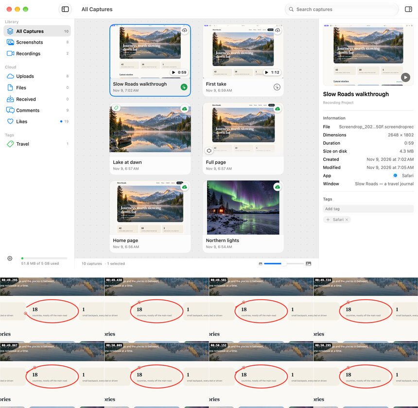</a>

- **Bug Report**, under **Bug Reports & Guides** in Studio, in the Library's right-click menu, or by itself after a **Bug report** take, turns a recording into a walkthrough for a coding agent and a report for a person, in one folder. It copies a line asking an agent to read `prompt.md` and shows the person's report in Finder. `prompt.md` names the app that was in front when it started and the screen's pixel scale, and lists each click, pressed shortcut, pointer rest, scroll and pen stroke, with what was said, a still of the whole screen at each moment and a strip of frames around it. Stills and strips come from the recording itself, with the pointer ringed and the pen strokes drawn in, so click positions match them and the export takes seconds: cuts and speed changes apply, Studio's zoom, crop, background, camera and redactions don't. Clicks on Sukusho's recording bar (Stop, Pause, the pen) and the pause on a button before clicking it are left out.
  - The report for people is in the folder's `Bug Report` folder: `bug-report.html` holds its images and opens on its own, so it's the file to send, and `bug-report.md` with `images/` is for Jira, Linear or GitHub. It gives the environment (the app and its version, macOS and the screen's scale), the steps to reproduce (without pointer rests, which the prompt keeps), what happened from the narration, the take's app log when it has one, and the stills. An agent's export through Agent access writes it too, but leaves Finder alone.
  - It's saved in `~/Agent Prompts`, one folder per recording, named after the recording's package and replaced when you export again. `~/Agent Prompts/latest.json` names the newest export, so a terminal action can read it.
  - A progress ring shows on Studio's button and on the Library card while it works, and a short "ready to paste" chime plays when it's done if **Play sounds** is on.
  - On the Library card, a sparkles circle beside the title shows the prompt's state: green for the one `latest.json` names (click to show it in Finder), an outline for an older one (click to make it the newest), and an orange arrow when the recording was edited since (click to export it again).
  - Moving a recording to the Trash moves its prompt too.
- **How-To Guide**, beside Bug Report in Studio and the Library's right-click menu, writes the same moments as a step-by-step guide: a title and a numbered step for each click, shortcut, pointer rest, scroll and pen stroke, with its still and what was said. It saves a folder in your export location with `guide.html` (its images inside, so it opens on its own), `guide.md` and `images/`, copies the Markdown for Jira, Linear or GitHub with a note that the images are local files to attach, shows the folder in Finder, and plays the same "ready to paste" chime. Narration is used as transcribed.
- **Autosave and history:** Studio has no Save button: a project saves after a two-second pause, when you switch away, close or quit, and with **File → Save** (**Command + S**). **File → Revert To** goes back to the original recording, to how the window opened, or to one of the last five sessions. Double-click the title to rename the recording.

## Image editor

Editing is non-destructive. The untouched image and an editable copy of your markup are kept side by side, so annotations can be changed later, and exports render at the image's full resolution.

<a href="screenshots/editor.jpg">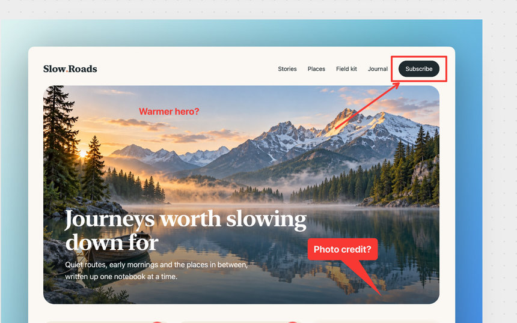</a>

- **Saves by itself** after a two-second pause, when you switch away, close or quit, and with **File → Save** (**Command + S**). The title bar shows the capture's name with **Edited**, **Saving…** or **Saved**; double-click it to rename. **File → Revert To** goes back to the capture as taken, to how the window opened, or to one of the last five sessions.
- **Tool dock** floating over the canvas: Select, rectangle, circle, Spotlight, arrow, straight line, freehand, Highlighter, text, numbered circle, magnifier, pixelate and blur, then **Crop**, **Pick Color**, **Measure** and a colour and size pill. Most tools have a single-key shortcut (R, O, L, A, N, T, M, P, B, and C for Crop).
- **Tools stay armed:** after you place an annotation it is selected and its tool stays active for the next one. **Escape** goes back to Select; a second **Escape** clears the selection. The Highlighter draws a straight horizontal or vertical line in see-through yellow, with its own remembered style.
- **Copy and paste:** **Command + C** and **Command + V** copy and paste the selected annotations. Paste an image from the clipboard to add it as a picture you can move and resize; dragging it past the edge grows the canvas.
- **Text labels** can sit in a box, with the text centred in it. Drag the round handle under a selected boxed label to pull out a speech-bubble tail; drop it back on the box to remove it. A selected **numbered circle** has the same handle for a short pointer.
- **Pick Color** copies a pixel's hex colour (or press **Tab** over the image). **Measure** shows the width and height under the pointer; hold **1** for height or **2** for width with any tool.
- **Crop** freeform or to a fixed ratio, or **Command-click** the image to crop to the box under the pointer. Annotations follow the crop.
- **Alignment guides:** shapes snap to each other and to the image's edges and centre, with alignment guides. The colour popover includes an opacity slider.
- **Find sensitive text…**, with pixelate or blur chosen, finds sensitive text and covers it.
- **Inspector:** **Styles** saves and reapplies a whole look, sets a default for new screenshots, and imports or exports `.sukushopreset` files (and still imports `.screendroppreset`). **Background** offers colours, gradients, wallpapers, your own images and [Unsplash](https://unsplash.com/oauth/applications) search with your own Access Key. Add padding, corner radius, shadow, a border, a watermark, a camera angle and progressive blur.

## Capture

Capture a display, a window, an area, a scrolling region, or just the text in an area. Sukusho runs from its menu bar item and global shortcuts:

| Default shortcut | Action |
| --- | --- |
| `Command + Shift + 1` | Capture full screen |
| `Command + Shift + 2` | Capture a window |
| `Command + Shift + 3` | Capture an area |
| `Command + Shift + 4` | Scrolling Capture |
| `Command + Shift + 5` | Capture Text to the clipboard |
| `Command + Shift + 6` | Screen recording |
| `Command + Shift + L` | Show the Library |

`Command + Shift + 3`, `4` and `5` are also macOS's own screenshot shortcuts, so turn those off in macOS's keyboard shortcut settings (under Screenshots) for Sukusho to get them. Change any shortcut in **Settings → Shortcuts**. If a shortcut can't be registered, Settings says why and keeps the previous one.

- **Screenshot options** in **Settings → Screenshots**: a 3, 5 or 10 second timer, window shadows, trimming the empty menu bar strip from full-screen captures on notched Macs, PNG or JPEG, and an option to also copy as TIFF for apps that can't paste PNG.
- **After each capture**, choose any of: show the preview, copy, save, upload and copy the link, and open the editor or pin the screenshot above other windows. Recordings have their own set, and open in Studio by default.
- **Floating preview cards** let you copy, drag, save, compress, pin, view, edit, upload or delete a capture. Rearrange their actions, and set where they appear and when they close, in **Settings → Overlay**.
- **Capture Text** drags out an area, reads its text on-device, and puts the text on the clipboard. No image is saved. A table or a list keeps its shape: **Paste** gives table cells and list items where the app takes them, and **Paste and Match Style** gives plain text, with a table's cells separated by tabs.
- **Open With → Sukusho** in Finder imports a copy of an image and opens the copy in the editor. The original file is never changed.

## Scrolling Capture

<a href="screenshots/scrolling-capture-strip.jpg">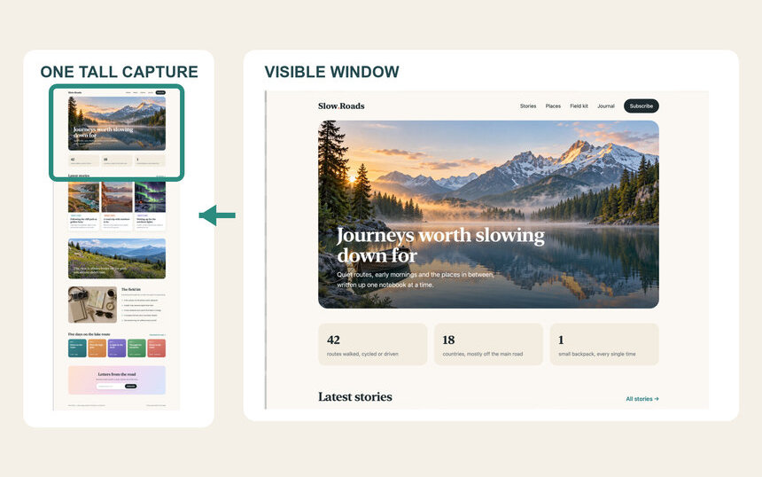</a>

Draw a box over a scrolling view, then scroll through it yourself or click the auto-scroll button on the capture bar. Sukusho lines up each new frame with the last one and adds only the rows that scrolled into view, giving one tall image up to 16,384 pixels high.

- **Auto-scroll** (the bar's button, or **Space**) moves the view a step at a time, paced by what has been captured, and finishes by itself at the end of the page. Scrolling yourself or moving the pointer off the bar hands control back to you. Auto-scroll needs the **Device Control and Data Access** permission (macOS 27's name for Accessibility); the bar offers to open it.
- **Frame checks:** every frame is checked before it's added. Apple's Vision framework proposes where the new frame fits, and Sukusho adds it only once an exact pixel match confirms it. A frame that doesn't fit is skipped, not joined in the wrong place.
- **Capture feedback:** the capture bar stays quiet through brief misses. If frames keep failing to fit, it says **Scroll back a little** when the view has moved past where it can line up, or **Something on the page keeps changing** for a video, an animation or a hover.
- **Live preview:** a live preview beside the box shows the whole capture so far, growing as you scroll, so a bad join is visible before you finish.
- **Finish anytime:** click **Done**, or press the Scrolling Capture shortcut again, to keep everything captured so far. At the height limit the capture stops and waits for **Done**.

Draw the box around the part that scrolls: a sidebar or button that stays put inside the box is repeated down the image.

## Automation

Shortcuts, Siri and Spotlight can take a full-screen, window or area screenshot, capture text, and start, stop or toggle a screen recording.

**Agent access** (**Settings → Agents**, off by default) lets coding agents such as Claude Code or Codex use Sukusho through a local MCP server inside the app (`Sukusho.app/Contents/Helpers/sukusho-mcp`). Agents can add and find captures, share one or a gallery, make file requests, list what clients sent, and read comments. Sukusho asks you in its own window before anything is shared, deleted or captured, and a share's password is typed by you in Share Options, never by the agent.

## About this project

Sukusho began as a fork of [Screendrop](https://github.com/fayazara/Screendrop) by Fayaz Ahmed. It is now a separate app with its own name, features, identity and Cloudflare Worker. The apps install side by side and do not share updates. Sukusho is not affiliated with or supported by Screendrop or its author. Please report Sukusho problems in [Issues](https://github.com/tommyent/sukusho/issues).

[Download Sukusho](https://github.com/tommyent/sukusho/releases/latest) as a signed and notarized app, or [build it from source](building.md). The app can check for updates. See the [website](https://tommyent.github.io/sukusho/). Sukusho is under active development, so expect rough edges.
